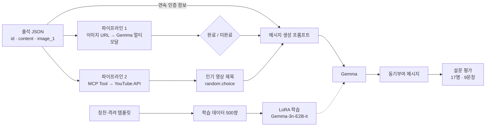

# 소형 언어 모델을 활용한 개인화된 학습 동기부여 메시지 생성 시스템

**KDBC 2025** · 이승현, 박호건 (성균관대학교 소프트웨어학과) · [논문](docs/KDBC_paper.pdf) · [발표 자료](docs/KDBC_presentation_PPT.pdf)

학생의 숙제 인증 이미지와 실시간 YouTube 콘텐츠를 결합해, LoRA로 미세조정한 **Gemma-3n-E2B-it**이 한 줄 동기부여 메시지를 생성하는 시스템입니다.
이 저장소는 논문 실험에 사용한 Colab 노트북과 MCP 코드를 **실행 순서대로** 정리한 것으로, 각 단계에서 어떤 데이터가 들어가고 어떤 데이터가 만들어지는지를 보여 줍니다.

---

## 개발 배경

기존 챗봇과 메시지 생성 시스템은 학생 개개인의 학습 상황을 반영하지 못하고, 일반적이고 반복적인 응원만 제공합니다.
본 연구는 **학생의 학습 성취(숙제 완료 여부)** 와 **실시간 트렌드(인기 콘텐츠)** 를 함께 반영한 개인화 메시지를 소형 언어 모델로 생성하는 것을 목표로 합니다.

## 시스템 흐름



## 단계별 데이터 흐름

| # | 단계 | 노트북 | 입력 | 생성되는 데이터 |
|---|---|---|---|---|
| 1 | 학습 데이터 생성 | [01](notebooks/01_lora_training.ipynb) | 칭찬 템플릿 32개 · 격려 템플릿 36개 | instruction 형식 **500쌍** (칭찬 250 · 격려 250) |
| 2 | LoRA 학습 | [01](notebooks/01_lora_training.ipynb) | 500쌍 | LoRA를 적용한 Gemma-3n-E2B-it |
| 3 | 숙제 인증 판별 | [02](notebooks/02_message_pipeline.ipynb) | 출석 JSON → 인증 이미지 URL | `완료` / `미완료` |
| 4 | 실시간 콘텐츠 수집 | [02](notebooks/02_message_pipeline.ipynb) · [mcp-upgrade](mcp-upgrade) | MCP Tool 호출 | YouTube 인기 영상 제목 10개 → 1개 무작위 선택 |
| 5 | 메시지 생성 | [02](notebooks/02_message_pipeline.ipynb) | 3 + 4 + 연속 인증 정보 + 가이드라인 | 30단어 이내 한 줄 메시지 |
| 6 | 설문 평가 | [04](notebooks/04_survey_analysis.ipynb) | 9문장 × 응답자 17명 | Krippendorff's α, Spearman ρ, Accuracy · F1 |
| 7 | 개선 | [03](notebooks/03_improvement.ipynb) | 3단 구조 템플릿 · 관심 아티스트 | 20단어 이내 3단 구조 메시지 |

---

## 1. 학습 데이터 생성과 LoRA 학습 — `01_lora_training.ipynb`

템플릿에서 응답을 무작위로 골라, 숙제 완료 여부와 인증 회차를 조합한 instruction 데이터를 만듭니다. 템플릿 원문은 [data/training_templates.json](data/training_templates.json)에 있습니다.

```python
{'input': '숙제를 완료하지 못한 아이에게 메세지 생성: 이번 챌린지 23회차 인증 (누적 22회 인증)',
 'output': '악동 김블루 영상처럼 즐겁게 배우는 게 제일 중요해. 오늘 못한 건 내일 보충하자 😄'}
```

학습 문장은 `<start_of_turn>user` / `<start_of_turn>model` 구분자로 구성하고, 최대 길이 128로 토큰화합니다.

| 구분 | 설정 |
|---|---|
| 모델 | Gemma-3n-E2B-it (`AutoTokenizer`, `AutoModelForCausalLM`) |
| LoRA | r=16, alpha=32, dropout=0.5, bias=none, target=`["q_proj", "v_proj"]`, task_type=CAUSAL_LM |
| 학습 | epochs=4, batch size=1, gradient accumulation=4, fp16 |
| 환경 | Google Colab, NVIDIA A100 (40GB) |

## 2. 메시지 생성 파이프라인 — `02_message_pipeline.ipynb`

**입력** — 숙제 인증 기록(JSON). 공개 저장소에서는 식별 정보를 예시 값으로 바꾸었습니다. ([data/sample_attendance.json](data/sample_attendance.json))

```json
{"id": "sample_001", "type": "attendance",
 "content": "이번 챌린지 54회차 인증 완료<br \\/>(누적 4회 인증)", "image_1": "sample_homework.jpg"}
```

**파이프라인 1 · 숙제 인증 판별** — `id`, `image_1`로 이미지 URL을 만들고, Gemma-3n-E2B-it(`AutoProcessor`, `Gemma3nForConditionalGeneration`)이 완료 여부만 출력합니다.

```
프롬프트: 당신은 학생의 숙제 인증 이미지를 분석하는 AI입니다. 이미지를 보고 숙제가 완료되었는지,
         아니면 미완료 상태인지 판단하세요. 다른 문장, 설명, 기호는 절대 출력하지 말 것.
결과:     완료
```

**파이프라인 2 · MCP Tool로 실시간 콘텐츠 수집** — [mcp-upgrade/mcp_server.py](mcp-upgrade/mcp_server.py)에 `youtube_trend`, `youtube_music` 도구를 등록하고, [main2.py](mcp-upgrade/main2.py)가 클라이언트 세션으로 도구를 호출해 YouTube Data API v3의 인기 급상승 영상 목록을 받습니다.

```
1. 임영웅 'ULSSIGU' M/V (Performance Ver.) (임영웅)
2. NMIXX(엔믹스) “Blue Valentine” Trailer: The Paradox of Love (JYP Entertainment)
3. [최신가요 실시간 인기차트] 2025년 9월 27일 4주차, ... (Beautiful Life)
   ... (총 10개)
→ random.choice(result_tool)로 1개 선택
```

**메시지 생성** — 도구 결과 `random.choice(result_tool)`, 판별 결과 `result_attendence`, 연속 인증 정보 `user_command_dict.get('content')`와 가이드라인을 프롬프트에 넣습니다.

> 1. 도구 결과를 메시지에 사용하고 학생의 수업/과제 상황과 자연스럽게 연결
> 2. 숙제 완료이면 칭찬, 미완료이면 격려
> 3. 자기결정성 이론에 따라 자율성 · 유능감 · 관계성을 북돋는 문장
> 4. 따뜻하고 유머러스한 말투
> 5. 30단어 이내의 한 줄

```
와! 챌린지 54회차까지 꾸준히 참여하다니 정말 대단해! 임영웅 'ULSSIGU'처럼 멋진 나를 발견하고, 스스로 할 수 있다는 유능감을 느껴보자! 😊
와, NMIXX의 'Blue Valentine'처럼 멋진 결과, 챌린지 54회차 인증 완료라니! 스스로 해낸 유능함에 자부심 느껴봐! ...
```

## 3. 설문 평가 — `04_survey_analysis.ipynb`

기존 문장(GPT-5), LoRA 학습 이전 Gemma 문장, LoRA 학습 이후 Gemma 문장을 각각 3개씩, 총 9문장을 블라인드로 평가했습니다.
응답자는 17명(성인 13명, 학생 4명)이며, 각 문장을 5점 척도로 평가했습니다.

| 문항 | 내용 |
|---|---|
| 자연스러움 | 메시지가 자연스러운 문장인가 |
| 공감도 | 따뜻하고 긍정적인 감정을 전달하는가 |
| 선호도 | 이 메시지를 실제로 받고 싶은가 |
| 숙제 완료율 예측 | 이 메시지를 받는 학생의 숙제 완료율을 어떻게 예상하는가 |

평가 문장 예시 (LoRA 학습 이후):

> IVE의 'ATTITUDE'처럼 멋진 챌린지 완수했네! 스스로 해냈다는 유능감과 성취감을 느껴보자. 이 맛에 계속 도전할 수 있어, 응원할게! 😊

| 지표 | 값 |
|---|---|
| Krippendorff's α (자연스러움 · 공감도 · 선호도) | 0.61 · 0.62 · 0.62 |
| 숙제 완료율 예측 Spearman ρ | 0.878 |
| 숙제 완료율 예측 Accuracy · F1 | 0.83 · 0.80 |

메시지 유형별 평균 점수는 논문 표 2에 정리되어 있습니다.

## 4. 개선: 3단 구조와 관심사 MCP Tool — `03_improvement.ipynb`

평가에서 확인한 한계(추상적 표현, 문장 구조 불안정, 개인 관심사와의 연계 부족)를 보완했습니다.

| 구분 | 기존 프롬프트 | 변경 프롬프트 |
|---|---|---|
| 도구 결과 | 인기 급상승 영상 무작위 선택 | 입력한 관심 아티스트의 검색 결과 |
| 메시지 구조 | 구조 지시 없음 | 안심 → 칭찬/격려 → 참여 유도 |
| 문장 길이 | 30단어 이내 | 20단어 이내 |

3단 구조 템플릿(칭찬 50개 · 격려 50개)으로 LoRA를 다시 학습해 `gemma-LoRA`로 저장하고, 관심 아티스트 `아이유 에스파 방탄소년단`의 검색 결과로 메시지를 생성했습니다.

```
아이유의Playlist처럼 즐겁게 숙제 마무리했네! 스스로 해냈다는 유능감과 다음 도전을 향한 자율성을 키우자!
와, Dynamite처럼 신나는 결과야! 자기 주도적으로 문제를 해결해서 대단해, 내일도 즐겁게 참여하자!
```

---

## 저장소 구조

```
KDBC_2025/
├─ notebooks/
│  ├─ 01_lora_training.ipynb       학습 데이터 500쌍 생성 → LoRA 학습 → 생성 확인
│  ├─ 02_message_pipeline.ipynb    출석 JSON → 숙제 판별 + MCP 콘텐츠 수집 → 메시지 생성
│  ├─ 03_improvement.ipynb         3단 구조 재학습 → 관심사 검색 → 개선 메시지 생성
│  └─ 04_survey_analysis.ipynb     설문 점수 → α · 평균 · Spearman · Accuracy/F1
├─ mcp-upgrade/                    MCP Server · Client
│  ├─ mcp_server.py                도구 등록 (youtube_trend, youtube_music, calculator)
│  ├─ main2.py                     도구 호출 → 인기 영상 목록 출력 (02에서 실행)
│  ├─ mcp/                         ClientSession, stdio 연결, FastMCP
│  └─ tools/                       YouTube Data API v3 호출
├─ data/
│  ├─ training_templates.json      학습 템플릿 (3.3절 · 5장)
│  └─ sample_attendance.json       입력 JSON 형식 예시
├─ docs/                           논문 · 발표 자료
└─ requirements.txt
```

노트북의 실행 결과는 원본 Colab 실행 출력을 그대로 두고, 설치 로그와 진행률 표시만 정리했습니다.

## 실행 방법

노트북은 Google Colab(GPU: A100)에서 Google Drive를 마운트해 실행합니다. Drive는 다음과 같이 구성합니다.

```
MyDrive/
├─ gemma-3n-E2b-it/        Hugging Face google/gemma-3n-E2B-it 모델 파일
├─ gemma-LoRA/             03에서 저장되는 병합 모델
└─ MCP/mcp-upgrade/        이 저장소의 mcp-upgrade 폴더 (+ .env)
```

1. Colab 보안 비밀에 `YOUTUBE_API`(YouTube Data API v3 키)를 등록하고, `mcp-upgrade/.env.example`을 `.env`로 복사해 같은 키를 넣습니다.
2. `01` → `02` → `03` 순서로 실행합니다. `03`의 메시지 생성 단계는 `02`의 입력·판별 결과와 생성 함수를 사용하므로 같은 런타임에서 이어서 실행합니다.
3. `04`는 설문 점수만 사용하므로 GPU 없이 단독으로 실행할 수 있습니다.

MCP 도구만 확인할 때는 다음과 같이 실행합니다.

```bash
cd mcp-upgrade
pip install requests python-dotenv
python main2.py
```

## 공개 범위

학생 프로필, 실제 숙제 인증 이미지, 학습된 모델 가중치는 포함하지 않습니다. 출석 JSON의 식별 값과 이미지 저장소 주소는 예시 값으로 바꾸었고, API 키는 환경변수와 Colab 보안 비밀로 읽도록 했습니다.
